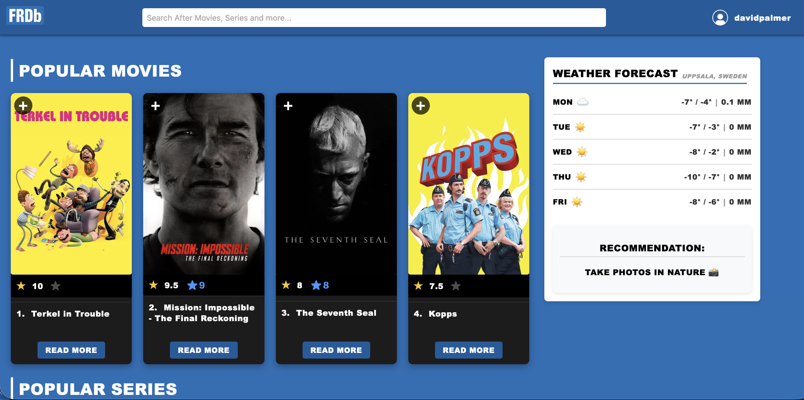
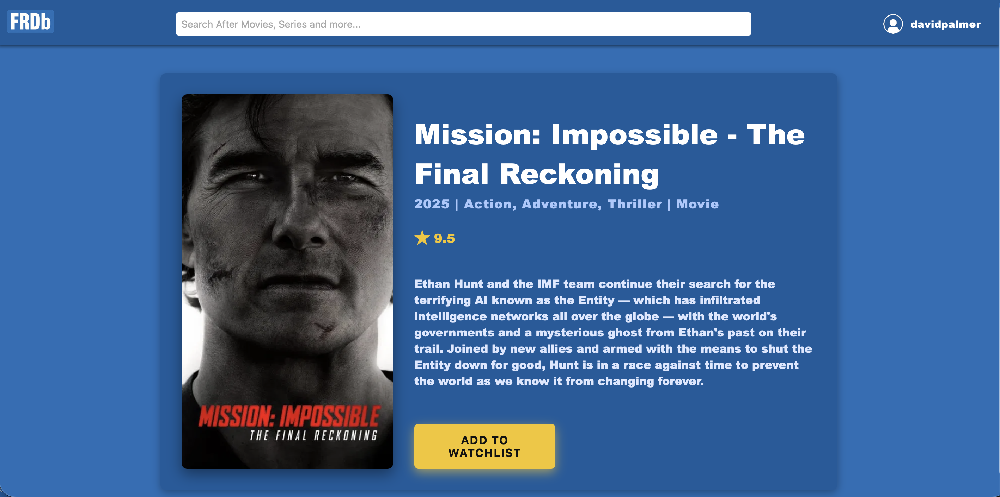
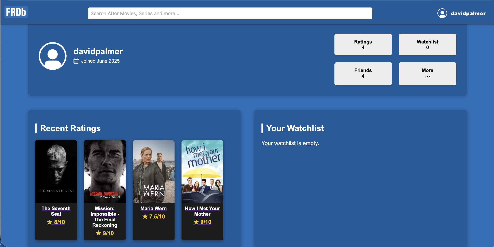

# FRDb – Film Review Database

An IMDb-inspired movie database built with PHP and SQLite.  
The application integrates external APIs (TMDb for movie data and Open-Meteo for weather data) to provide dynamic, weather-based recommendations:
- ☀️ **Nice weather** → Recommends an outdoor activity
- 🌧️ **Bad weather** → Recommends a movie

## 📸 Screenshots

---
*Developed by Adam Larsson, Filip Sundberg, and Teodor Tjernberg.*